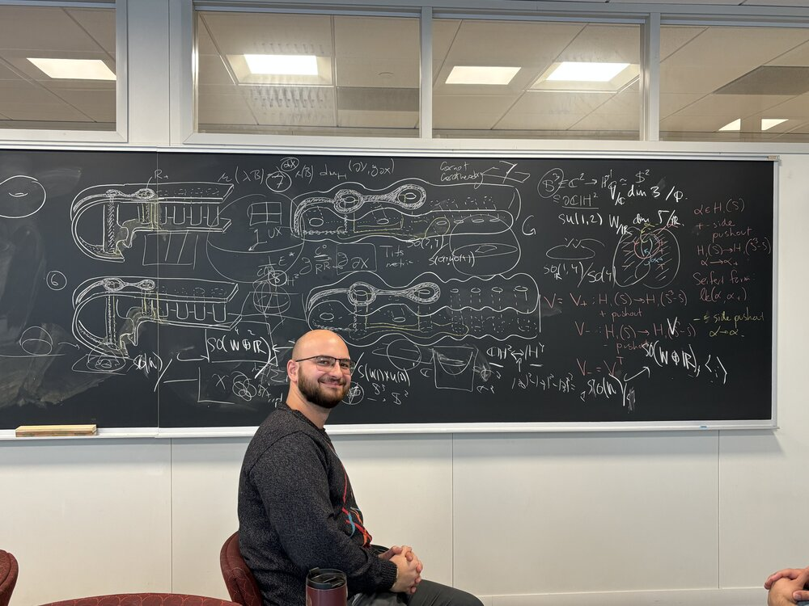

# About me

<figure class="portrait">
  
  <figcaption>
    Credits for the picture go to <a href="https://sites.google.com/view/joeboninger">Joe Boninger</a>. 
    The sutures are his, but the bad handwriting is mine!
  </figcaption>
</figure>

I am a fifth-year Ph.D. candidate at Boston College, advised by [Martin Bridgeman](https://sites.google.com/bc.edu/martin-bridgeman/).

I’m currently in the job market!
You can find my CV  [here](/pdfs/cv-long.pdf) (updated Sep 3) and my papers [here](/research).

I spend most of my time thinking about discrete subgroups of Lie groups, especially Anosov representations.
I really enjoy talking about math and meeting people - please don’t hesitate to reach out to me!

Before coming to Boston, I earned my Master’s degree at UdelaR (Uruguay, where I’m originally from), under the supervision of [Rafael Potrie](https://sites.google.com/view/rafaelpotrie/home).

**Contact:** lemajo (at) bc (dot) edu  
**Office:** 540 Maloney Hall,. Department of Mathematics, Boston College. Chestnut Hill, MA
